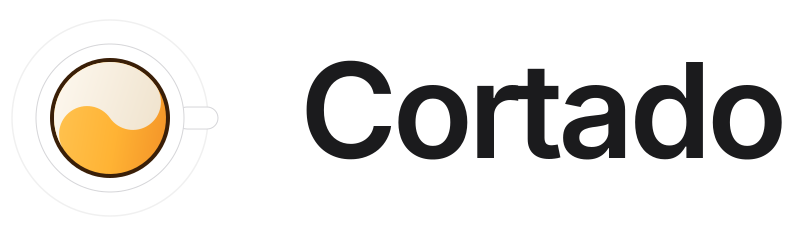
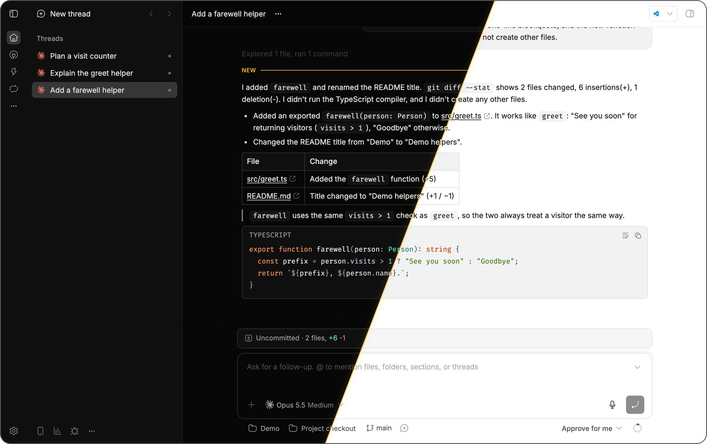
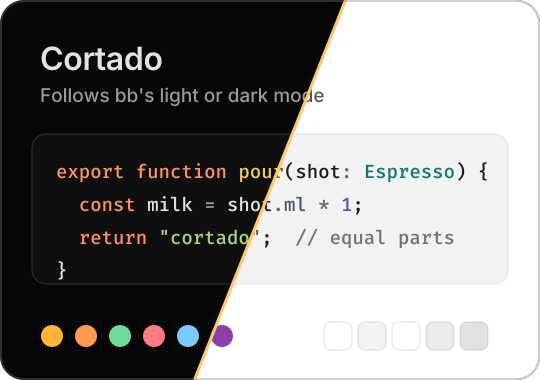
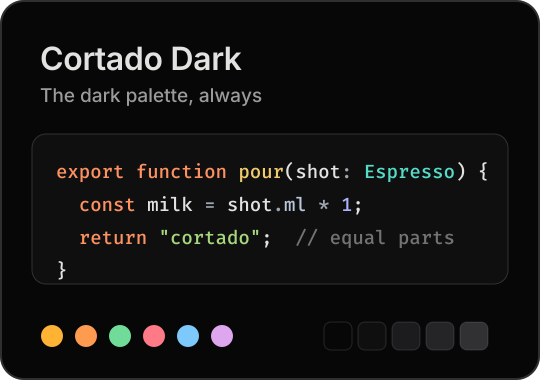
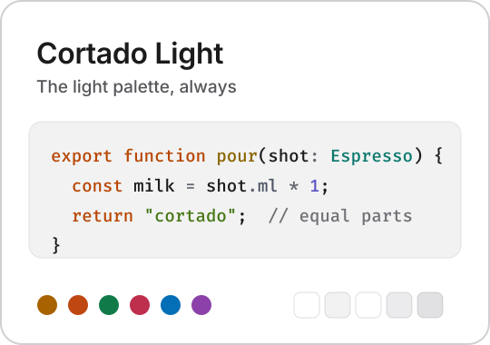
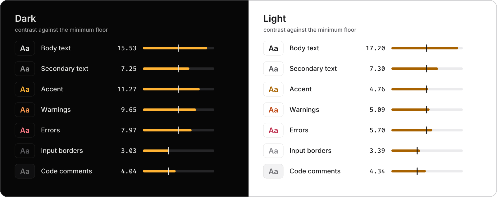
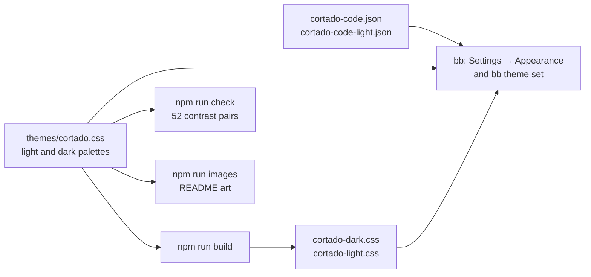
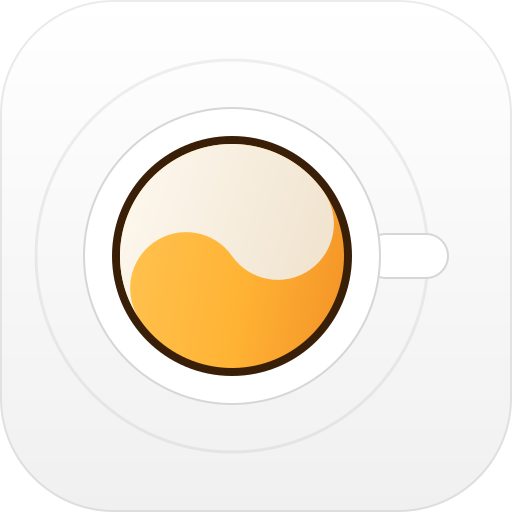

<p align="center">
  <picture>
    <source media="(prefers-color-scheme: dark)" srcset="assets/wordmark-dark.svg">
    
  </picture>
</p>

<p align="center"><b>Graphite and amber for <a href="https://getbb.app">bb</a>, in light and dark.</b></p>

<p align="center">
<a href="https://github.com/vburojevic/bb-plugin-cortado/releases/latest"><picture><source media="(prefers-color-scheme: dark)" srcset="https://img.shields.io/github/v/release/vburojevic/bb-plugin-cortado?style=flat-square&label=release&color=ffb334&labelColor=1c1c1e"></picture></a>
<a href="https://getbb.app"><picture><source media="(prefers-color-scheme: dark)" srcset="https://img.shields.io/badge/bb-%E2%89%A50.48-ffb334?style=flat-square&labelColor=1c1c1e"></picture></a>
<a href="LICENSE"><picture><source media="(prefers-color-scheme: dark)" srcset="https://img.shields.io/badge/license-MIT-ffb334?style=flat-square&labelColor=1c1c1e"></picture></a>
<a href="#contrast"><picture><source media="(prefers-color-scheme: dark)" srcset="https://img.shields.io/badge/contrast-52%2F52%20pass-ffb334?style=flat-square&labelColor=1c1c1e"></picture></a>
<a href="#three-palettes"><picture><source media="(prefers-color-scheme: dark)" srcset="https://img.shields.io/badge/palettes-3-ffb334?style=flat-square&labelColor=1c1c1e"></picture></a>
</p>

<a href="assets/full/hero.png?raw=true"></a>

<p align="center"><sub>One bb window, Cortado Dark on the left and Cortado Light on the right. <a href="assets/full/hero.png?raw=true">Open full size</a></sub></p>

<p align="center">
  <picture>
    <source media="(prefers-color-scheme: dark)" srcset="assets/divider-dark.svg">
    
  </picture>
</p>

## Install

```sh
bb plugin install git:github.com/vburojevic/bb-plugin-cortado@v1.0.0 --yes
```

> [!TIP]
> Then pick it under **Settings → Appearance → Palette**, or from a terminal:
>
> ```sh
> bb theme set plugin:cortado:cortado
> ```

<sub>Code renders in <a href="https://github.com/tonsky/FiraCode">Fira Code</a> and the terminal in <a href="https://www.nerdfonts.com/font-downloads">FiraCode Nerd Font Mono</a>. Install both, or bb falls back to your system's monospace font.</sub>

<p align="center">
  <picture>
    <source media="(prefers-color-scheme: dark)" srcset="assets/divider-dark.svg">
    
  </picture>
</p>

## Three palettes

<p align="center">
<a href="assets/full/hero.png?raw=true"></a>
<a href="assets/full/thread-dark.png?raw=true"></a>
<a href="assets/full/thread-light.png?raw=true"></a>
</p>

<p align="center"><code>cortado</code> · <code>cortado-dark</code> · <code>cortado-light</code></p>

**Cortado** follows bb's Light, Dark or System setting. **Cortado Dark** and **Cortado Light** keep one palette whichever way that switch is set. Each recolors the app, the syntax colors in chat, diffs and file previews, and the 16 terminal colors.

```sh
bb theme set plugin:cortado:cortado         # follows bb's mode
bb theme set plugin:cortado:cortado-dark    # always dark
bb theme set plugin:cortado:cortado-light   # always light
```

<p align="center">
  <picture>
    <source media="(prefers-color-scheme: dark)" srcset="assets/divider-dark.svg">
    
  </picture>
</p>

## A closer look

### Diffs and file previews

bb draws diffs, file previews and the file editor with a code theme of its own. Cortado brings one for each mode, drawn from the same palette as code in chat.

<a href="assets/full/diff-dark.png?raw=true#gh-dark-mode-only"></a><a href="assets/full/diff-light.png?raw=true#gh-light-mode-only"></a>
<p align="center"><sub>Full size: <a href="assets/full/diff-dark.png?raw=true">dark</a> · <a href="assets/full/diff-light.png?raw=true">light</a></sub></p>

### Right in Settings

All three palettes appear under **Settings → Appearance → Palette**, next to bb's built-in ones.

<a href="assets/full/palettes-dark.png?raw=true#gh-dark-mode-only"></a><a href="assets/full/palettes-light.png?raw=true#gh-light-mode-only"></a>
<p align="center"><sub>Full size: <a href="assets/full/palettes-dark.png?raw=true">dark</a> · <a href="assets/full/palettes-light.png?raw=true">light</a></sub></p>

### Warm where it counts

Amber marks what matters: search matches, the unread line and primary buttons.

<a href="assets/full/search-dark.png?raw=true#gh-dark-mode-only"></a><a href="assets/full/search-light.png?raw=true#gh-light-mode-only"></a>
<p align="center"><sub>Full size: <a href="assets/full/search-dark.png?raw=true">dark</a> · <a href="assets/full/search-light.png?raw=true">light</a></sub></p>

### Depth you can read

Menus sit one step above the sidebar and the sidebar one step above the chat, so every layer separates without heavy borders.

<a href="assets/full/menu-dark.png?raw=true#gh-dark-mode-only"></a><a href="assets/full/menu-light.png?raw=true#gh-light-mode-only"></a>
<p align="center"><sub>Full size: <a href="assets/full/menu-dark.png?raw=true">dark</a> · <a href="assets/full/menu-light.png?raw=true">light</a></sub></p>

<p align="center">
  <picture>
    <source media="(prefers-color-scheme: dark)" srcset="assets/divider-dark.svg">
    
  </picture>
</p>

## On your phone

bb's phone layout gets the same palette, in both modes. Tap a phone for its full-size screen.

<p align="center">
<a href="assets/full/thread-phone-dark.png?raw=true#gh-dark-mode-only"></a><a href="assets/full/thread-phone-light.png?raw=true#gh-light-mode-only"></a>
<a href="assets/full/plan-phone-dark.png?raw=true#gh-dark-mode-only"></a><a href="assets/full/plan-phone-light.png?raw=true#gh-light-mode-only"></a>
<a href="assets/full/settings-phone-dark.png?raw=true#gh-dark-mode-only"></a><a href="assets/full/settings-phone-light.png?raw=true#gh-light-mode-only"></a>
</p>

<p align="center"><sub>A thread, a numbered plan and Settings. Full size: Thread <a href="assets/full/thread-phone-dark.png?raw=true">dark</a> / <a href="assets/full/thread-phone-light.png?raw=true">light</a> · Plan <a href="assets/full/plan-phone-dark.png?raw=true">dark</a> / <a href="assets/full/plan-phone-light.png?raw=true">light</a> · Settings <a href="assets/full/settings-phone-dark.png?raw=true">dark</a> / <a href="assets/full/settings-phone-light.png?raw=true">light</a></sub></p>

<p align="center">
  <picture>
    <source media="(prefers-color-scheme: dark)" srcset="assets/divider-dark.svg">
    
  </picture>
</p>

## Colors

<a href="assets/palette.svg?raw=true#gh-dark-mode-only"></a><a href="assets/palette-light.svg?raw=true#gh-light-mode-only"></a>

The grays carry no tint, so the warm colors do the work. In dark mode the sidebar and side panels sit one step above the chat; in light mode they sit one step grayer than the white chat.

<a href="assets/code.svg?raw=true#gh-dark-mode-only"></a><a href="assets/code-light.svg?raw=true#gh-light-mode-only"></a>

Code keeps its warmth in orange keywords and gold function names. Types, strings and numbers are teal, green and violet in diffs and file previews; in chat, numbers take the type color.

## Contrast

<a href="assets/contrast.svg?raw=true"></a>

`npm run check` reads every color from the stylesheet and tests 26 pairs in each mode against minimum contrast floors, most of them from WCAG. The marks show each floor; the bars run on a log scale to 21:1.

<p align="center">
  <picture>
    <source media="(prefers-color-scheme: dark)" srcset="assets/divider-dark.svg">
    
  </picture>
</p>

## Reference

<details>
<summary><b>Every surface, and where bb uses it</b> (18 tokens)</summary>
<br>

| Where in bb | Token | Dark | Light |
| :-- | :-- | :-- | :-- |
| Chat, thread header, composer bar | `--canvas` | `#070707` | `#ffffff` |
| Sidebar, icon rail, side panels, code | `--sidebar`, `--surface-recessed` | `#0f0f10` | `#f2f2f3` |
| Cards | `--card` | `#0f0f10` | `#f6f6f7` |
| Menus, popovers, the command palette | `--popover` | `#1c1c1e` | `#ffffff` |
| Secondary buttons, the current line in code | `--secondary` | `#252527` | `#ebebed` |
| Hovered rows in menus | `--accent` | `#2b2b2e` | `#e6e6e8` |
| Borders | `--border` | `#313134` | `#e1e1e3` |
| Input borders | `--input` | `#5c5c60` | `#8b8b90` |
| Selected cards, your own chips, quote bars | `--surface-selected-border` | `#85858a` | `#6b6b70` |
| Body text | `--ink` | `#e2e2e0` | `#1b1b1d` |
| Secondary text | `--muted-foreground` | `#9b9b9b` | `#56565b` |
| Accent, primary buttons | `--primary` | `#ffb334` | `#a86200` |
| Focus rings | `--ring` | `#ffb334` | `#b87400` |
| Warnings | `--warning` | `#ff9b50` | `#bf4712` |
| Errors | `--destructive-text` | `#fd7a86` | `#be2e4d` |
| Success, added lines | `--success` | `#71db9a` | `#107b49` |
| File paths | `--file-accent` | `#7dc9fc` | `#046eb6` |

</details>

<details>
<summary><b>Syntax colors in chat</b> (7 properties)</summary>
<br>

bb highlights code blocks in chat with [sugar-high](https://github.com/huozhi/sugar-high), which reads its colors from `--sh-*` properties. Diffs and file previews use the code theme files instead, which set numbers in violet.

| Property | Colors | Dark | Light |
| :-- | :-- | :-- | :-- |
| `--sh-keyword` | Keywords: `export`, `const`, `return` | `#fd9260` | `#b84703` |
| `--sh-entity` | Function names | `#f0cb6e` | `#8b6500` |
| `--sh-class` | Types, class names and numbers | `#55dcc8` | `#0c796e` |
| `--sh-string` | Strings | `#a6d77d` | `#487817` |
| `--sh-jsxliterals` | Text inside JSX | `#b0b2fd` | `#5951c1` |
| `--sh-property` | Properties | `#b9c6d9` | `#4b5563` |
| `--sh-comment` | Comments | `#737373` | `#717176` |

</details>

<details>
<summary><b>Terminal colors</b> (16 colors)</summary>
<br>

| # | Color | Dark | Light |
| --: | :-- | :-- | :-- |
| 0 | Black | `#3a3a3d` | `#3a3a3d` |
| 1 | Red | `#f05f5f` | `#c4262e` |
| 2 | Green | `#5fcf8c` | `#17774c` |
| 3 | Yellow | `#f0b04a` | `#a86200` |
| 4 | Blue | `#6db8f0` | `#0a6bbd` |
| 5 | Magenta | `#a99cf5` | `#6b45d1` |
| 6 | Cyan | `#52cdbd` | `#0a7a6d` |
| 7 | White | `#d0d0ce` | `#6b6b70` |
| 8 | Bright black | `#737373` | `#5f5f64` |
| 9 | Bright red | `#ff7b7b` | `#d12b33` |
| 10 | Bright green | `#7fe3a8` | `#1d8a59` |
| 11 | Bright yellow | `#ffc861` | `#b86e00` |
| 12 | Bright blue | `#8cd2ff` | `#1f7fd1` |
| 13 | Bright magenta | `#c3b1ff` | `#7c55e0` |
| 14 | Bright cyan | `#6fe3d3` | `#0d8f80` |
| 15 | Bright white | `#f2f2f0` | `#1b1b1d` |

</details>

<details>
<summary><b>How it works</b></summary>
<br>



The stylesheet sets bb's own theme tokens and nothing else. It never targets bb's components, so there are no selectors to break when bb changes its markup.

</details>

<details>
<summary><b>Change it</b></summary>
<br>

A local install is read live, so you can tune the theme in place:

```sh
git clone https://github.com/vburojevic/bb-plugin-cortado
cd bb-plugin-cortado && npm install
bb plugin install . --yes
```

Edit `themes/cortado.css` for the app and `themes/cortado-code.json` or `themes/cortado-code-light.json` for diffs and file previews. Then:

```sh
npm run build    # regenerate Cortado Dark and Cortado Light from cortado.css
npm run check    # contrast in both modes, and stale files
npm run images   # redraw the logo, wordmark, cards, palette and contrast art
bb theme set plugin:cortado:cortado
```

```
themes/cortado.css             light and dark palettes, shadows, fonts, terminal colors
themes/cortado-dark.css        Cortado Dark, generated
themes/cortado-light.css       Cortado Light, generated
themes/cortado-code.json       code theme for diffs and file previews, dark
themes/cortado-code-light.json code theme for diffs and file previews, light
scripts/build-variants.mjs     writes the two fixed palettes
scripts/check-contrast.mjs     the contrast check behind npm run check
scripts/render-images.mjs      draws the README art from the theme
docs/overview.md               the bb marketplace description
server.ts                      the empty server entry bb requires
assets/                        logo, glyph and drawn README art
assets/screens/                README screenshots
assets/full/                   the same screenshots at full size
```

</details>

<details>
<summary><b>About the images</b></summary>
<br>

The screenshots are captured from bb 0.49 itself, running headless with its own empty data folder and Cortado 1.0.0 installed from the release tag. The threads show an invented change to a sample file. Nothing comes from anyone's real bb. Desktop shots are taken at 2x and phone shots at 3x; the files under `assets/full/` keep that full resolution.

The wordmark, palette cards, color, code and contrast images are drawn by `npm run images`, which reads every color from `themes/cortado.css` and the code theme files. Regenerating after a palette change keeps them honest.

</details>

<p align="center">
  <picture>
    <source media="(prefers-color-scheme: dark)" srcset="assets/divider-dark.svg">
    
  </picture>
</p>

<p align="center">
  <picture>
    <source media="(prefers-color-scheme: dark)" srcset="assets/logo.svg">
    
  </picture>
  <br>
  <sub>Fills and lines follow the step roles of <a href="https://www.radix-ui.com/colors/docs/palette-composition/understanding-the-scale">Radix Colors</a>. Type is <a href="https://rsms.me/inter/">Inter</a> by Rasmus Andersson and <a href="https://github.com/tonsky/FiraCode">Fira Code</a> by Nikita Prokopov. <a href="LICENSE">MIT licensed</a>.</sub>
  <br><br>
  More bb plugins at <a href="https://github.com/vburojevic/bb-plugins"><b>vburojevic/bb-plugins</b></a>
</p>
