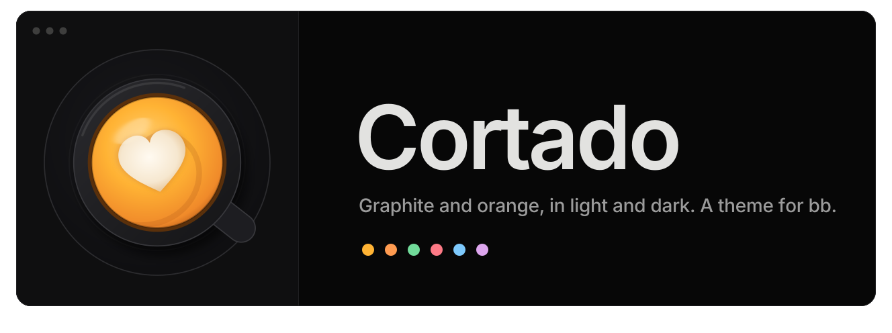
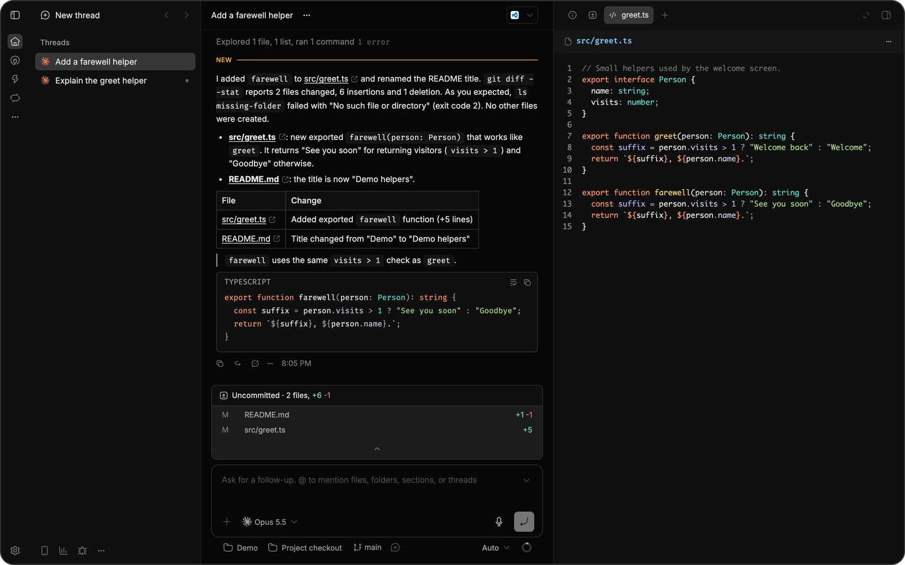
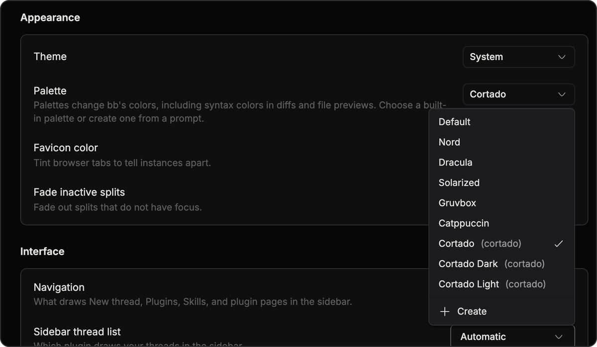
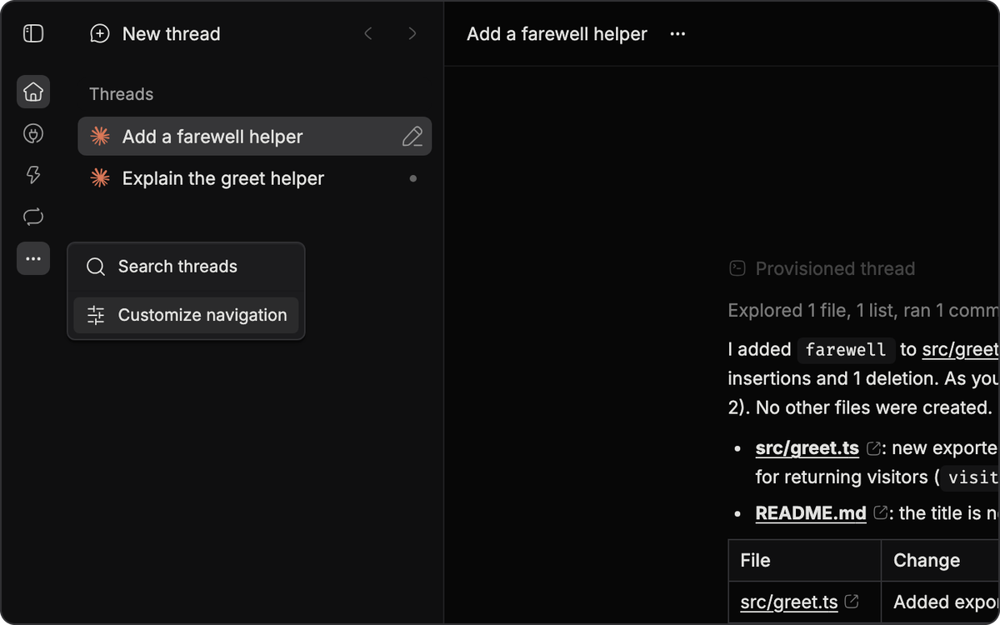
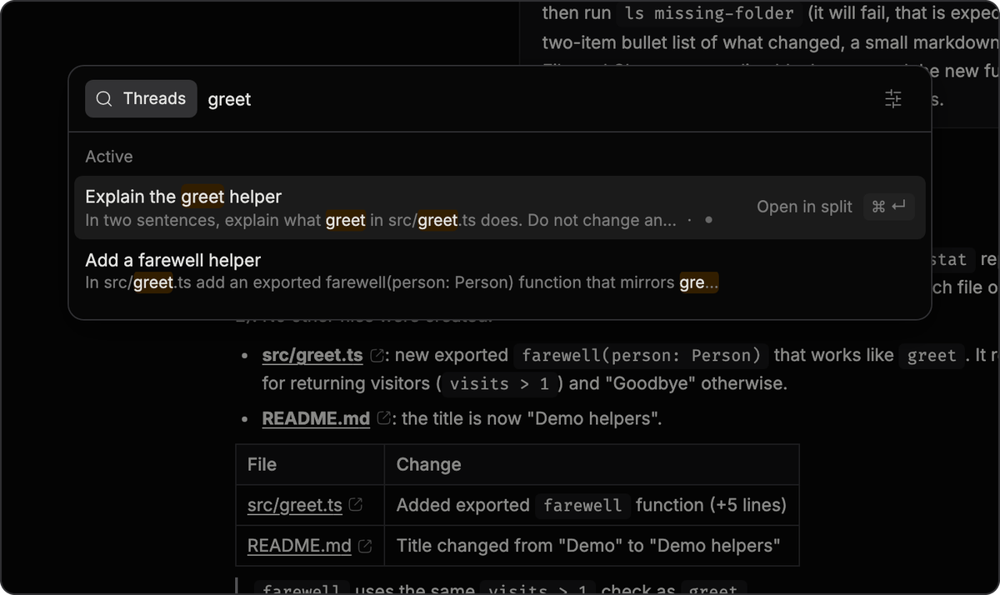
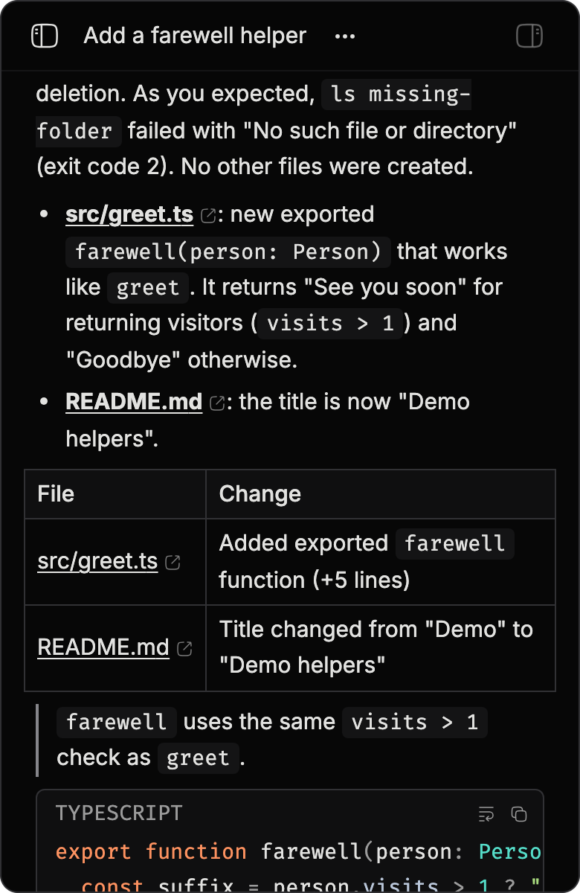
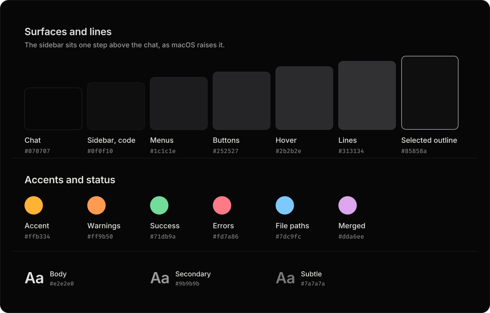
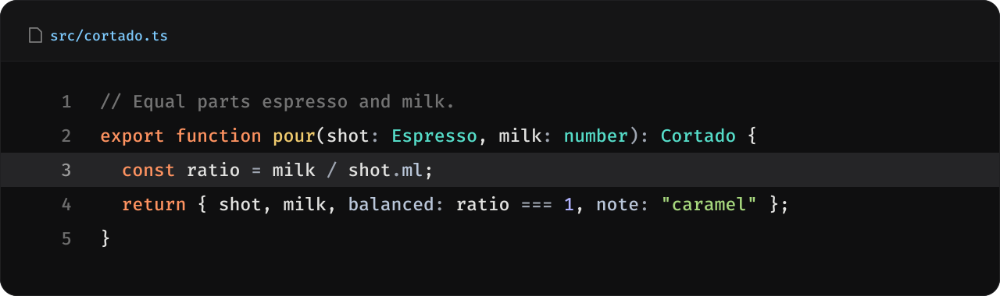

<picture>
  <source media="(prefers-color-scheme: dark)" srcset="assets/banner.svg">
  <source media="(prefers-color-scheme: light)" srcset="assets/banner-light.svg">
  
</picture>

<p>
  
  
  
</p>

Cortado is a theme for [bb](https://getbb.app) in neutral graphite with warm orange and amber, in light and dark. The grays carry no tint, so the warm colors do the work. The accent is amber and warnings are orange. In code, orange keywords and gold function names sit beside teal types, green strings and violet numbers.

<picture>
  <source media="(prefers-color-scheme: dark)" srcset="assets/screens/thread-dark.png">
  <source media="(prefers-color-scheme: light)" srcset="assets/screens/thread-light.png">
  
</picture>

<sub>The screenshots on this page follow your GitHub theme. Switch GitHub to light or dark to see the other mode.</sub>

## Install

```sh
bb plugin install git:github.com/vburojevic/bb-plugin-cortado@v1.0.0 --yes
bb theme set plugin:cortado:cortado
```

Or pick it in bb under **Settings → Appearance → Palette**.

> [!IMPORTANT]
> Code renders in [Fira Code](https://github.com/tonsky/FiraCode) and the terminal in [FiraCode Nerd Font Mono](https://www.nerdfonts.com/font-downloads). Install both first, or bb falls back to your system's monospace font.

## Three palettes

| Palette | What it does | Command |
| :-- | :-- | :-- |
| **Cortado** | Follows bb's Light, Dark or System setting | `bb theme set plugin:cortado:cortado` |
| **Cortado Dark** | The dark palette in both modes | `bb theme set plugin:cortado:cortado-dark` |
| **Cortado Light** | The light palette in both modes | `bb theme set plugin:cortado:cortado-light` |

<picture>
  <source media="(prefers-color-scheme: dark)" srcset="assets/screens/palettes-dark.png">
  <source media="(prefers-color-scheme: light)" srcset="assets/screens/palettes-light.png">
  
</picture>

## A closer look

<table>
  <tr>
    <td width="50%" valign="top">
      <picture>
        <source media="(prefers-color-scheme: dark)" srcset="assets/screens/menu-dark.png">
        <source media="(prefers-color-scheme: light)" srcset="assets/screens/menu-light.png">
        
      </picture>
      <p>Menus sit one step above the sidebar, so they read clearly over it.</p>
    </td>
    <td width="50%" valign="top">
      <picture>
        <source media="(prefers-color-scheme: dark)" srcset="assets/screens/search-dark.png">
        <source media="(prefers-color-scheme: light)" srcset="assets/screens/search-light.png">
        
      </picture>
      <p>Search matches are marked in amber, the same warm color as the accent.</p>
    </td>
  </tr>
  <tr>
    <td colspan="2" valign="top" align="center">
      <picture>
        <source media="(prefers-color-scheme: dark)" srcset="assets/screens/phone-dark.png">
        <source media="(prefers-color-scheme: light)" srcset="assets/screens/phone-light.png">
        
      </picture>
      <p>On a phone, tables, quotes and code still separate cleanly.</p>
    </td>
  </tr>
</table>

## Colors

<picture>
  <source media="(prefers-color-scheme: dark)" srcset="assets/palette.svg">
  <source media="(prefers-color-scheme: light)" srcset="assets/palette-light.svg">
  
</picture>

<picture>
  <source media="(prefers-color-scheme: dark)" srcset="assets/code.svg">
  <source media="(prefers-color-scheme: light)" srcset="assets/code-light.svg">
  
</picture>

Code keeps the warmth in two places, orange keywords and gold function names, and sets types, strings and numbers in teal, green and violet so they never compete with the accent.

In dark mode the sidebar, icon rail, side panels and code sit one step above the chat, the way macOS raises its sidebars. In light mode they sit one step grayer than the white chat. Fills and lines follow the step roles of [Radix Colors](https://www.radix-ui.com/colors/docs/palette-composition/understanding-the-scale).

Every color with a hue was tuned in OKLCH so it sits in one band of lightness and saturation per mode, with the code colors spread around the color wheel. Light mode uses a deeper amber, `#a86200`, so the accent still reads as text on white.

<details>
<summary><b>Every surface, and where bb uses it</b></summary>

<br>

| Where in bb | Token | Dark | Light |
| :-- | :-- | :-- | :-- |
| Chat, thread header, composer bar | `--canvas` | `#070707` | `#ffffff` |
| Sidebar, icon rail, side panels, code | `--sidebar`, `--surface-recessed` | `#0f0f10` | `#f2f2f3` |
| Cards | `--card` | `#0f0f10` | `#f6f6f7` |
| Menus, popovers, the command palette | `--popover` | `#1c1c1e` | `#ffffff` |
| Secondary buttons, the current line in code | `--secondary` | `#252527` | `#ebebed` |
| Hovered rows in menus | `--accent` | `#2b2b2e` | `#e6e6e8` |
| Borders | `--border` | `#313134` | `#e1e1e3` |
| Input borders | `--input` | `#5c5c60` | `#8b8b90` |
| Selected cards, your own chips, quote bars | `--surface-selected-border` | `#85858a` | `#6b6b70` |
| Accent | `--primary` | `#ffb334` | `#a86200` |
| Warnings | `--warning` | `#ff9b50` | `#bf4712` |

</details>

## Contrast

`npm run check` reads every color from the stylesheet and checks 26 pairs in each mode against minimum contrast floors, most of them from WCAG. It fails if any pair falls short.

| Pair | Dark | Light | Floor |
| :-- | --: | --: | --: |
| Body text on the chat | 15.53:1 | 17.20:1 | 4.5:1 |
| Secondary text on the chat | 7.25:1 | 7.30:1 | 4.5:1 |
| Accent on the chat | 11.27:1 | 4.76:1 | 4.5:1 |
| Warnings on the chat | 9.65:1 | 5.09:1 | 4.5:1 |
| Errors on the chat | 7.97:1 | 5.70:1 | 4.5:1 |
| Code comments on code panels | 4.04:1 | 4.34:1 | 3:1 |
| Input borders on the chat | 3.03:1 | 3.39:1 | 3:1 |

## Change it

A local install is read live, so you can tune the theme in place:

```sh
git clone https://github.com/vburojevic/bb-plugin-cortado
bb plugin install ./bb-plugin-cortado --yes
```

Edit [`themes/cortado.css`](themes/cortado.css) for the app and [`themes/cortado-code.json`](themes/cortado-code.json) or [`themes/cortado-code-light.json`](themes/cortado-code-light.json) for file previews and diffs. Then:

```sh
npm run build   # regenerate Cortado Dark and Cortado Light from cortado.css
npm run check   # contrast in both modes, and stale files
bb theme set plugin:cortado:cortado
```

> [!TIP]
> The stylesheet sets bb's own theme tokens and nothing else. It never targets bb's components, so there are no selectors to break when bb changes its markup.

```
themes/cortado.css             light and dark palettes, shadows, fonts, terminal colors
themes/cortado-dark.css        Cortado Dark, generated
themes/cortado-light.css       Cortado Light, generated
themes/cortado-code.json       code theme for file previews and diffs, dark
themes/cortado-code-light.json code theme for file previews and diffs, light
scripts/build-variants.mjs     writes the two fixed palettes
scripts/check-contrast.mjs     the contrast check behind npm run check
docs/overview.md               the bb marketplace description
server.ts                      the empty server entry bb requires
assets/                        icon, logo, banner and README images
```

## Credits

Cortado uses the step roles of [Radix Colors](https://www.radix-ui.com/colors), [Inter](https://rsms.me/inter/) by Rasmus Andersson and [Fira Code](https://github.com/tonsky/FiraCode) by Nikita Prokopov.

## License

[MIT](LICENSE)
