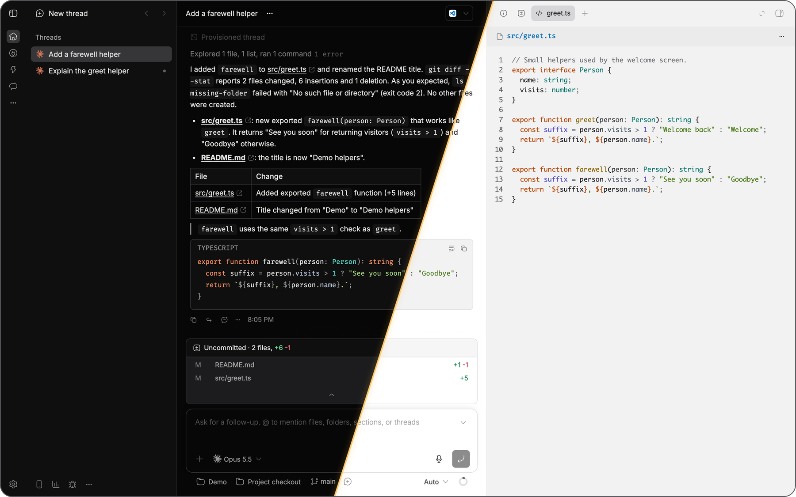
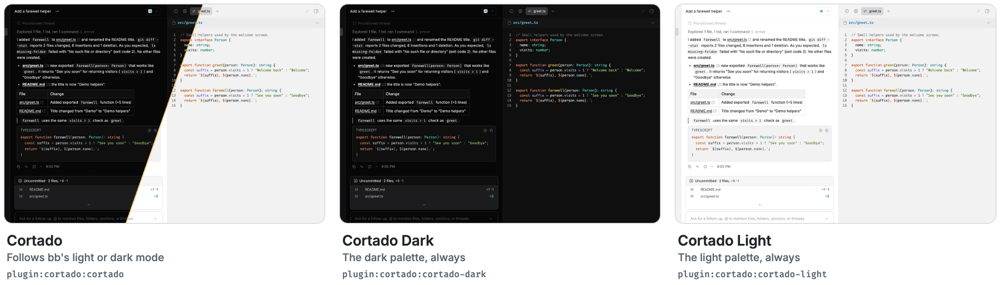
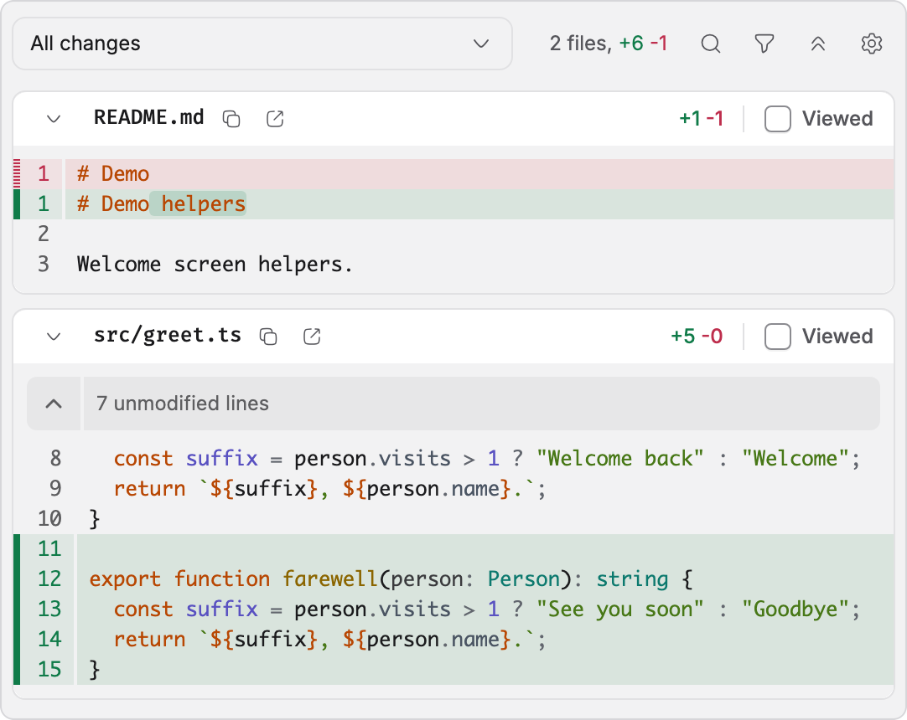
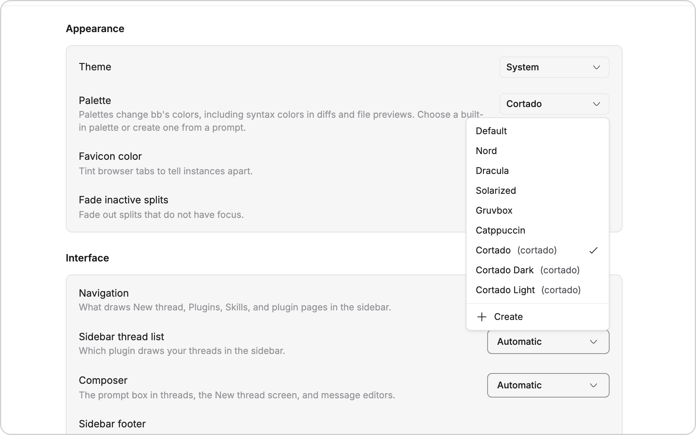
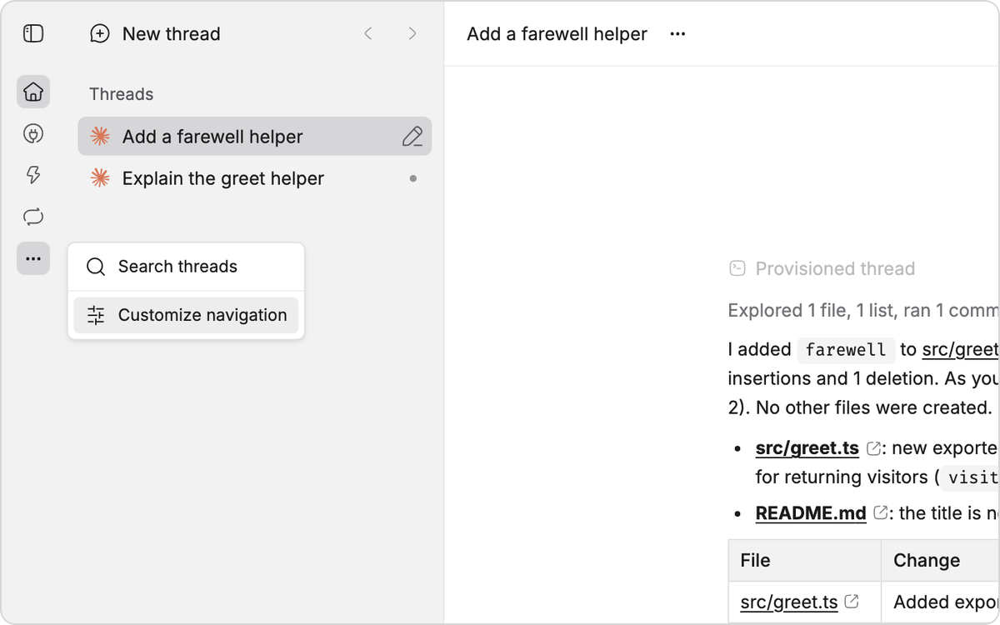
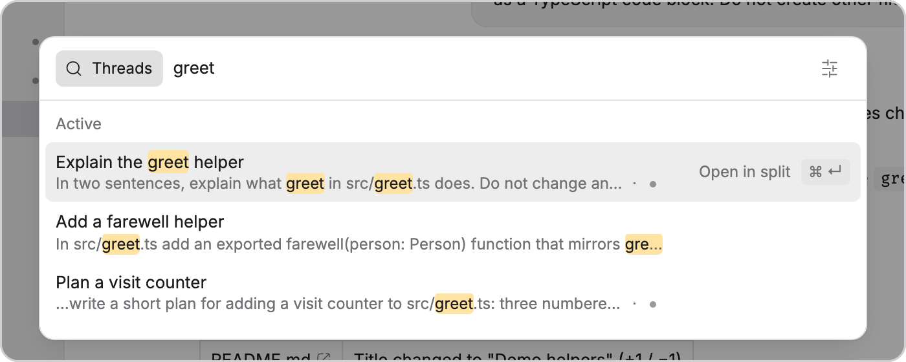
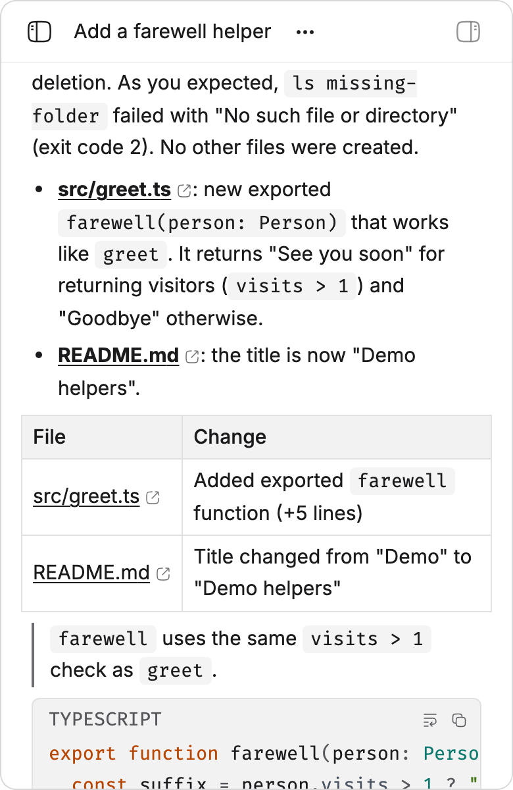
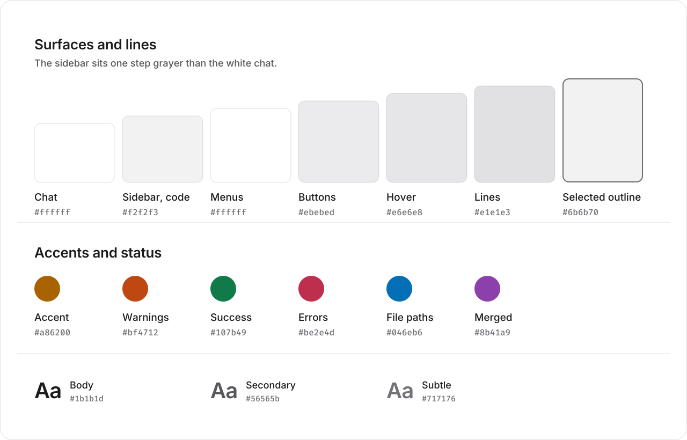
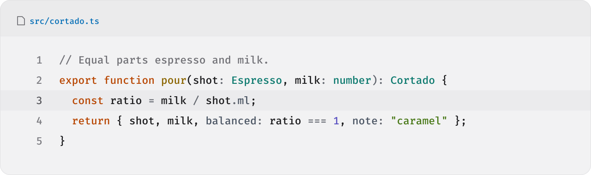
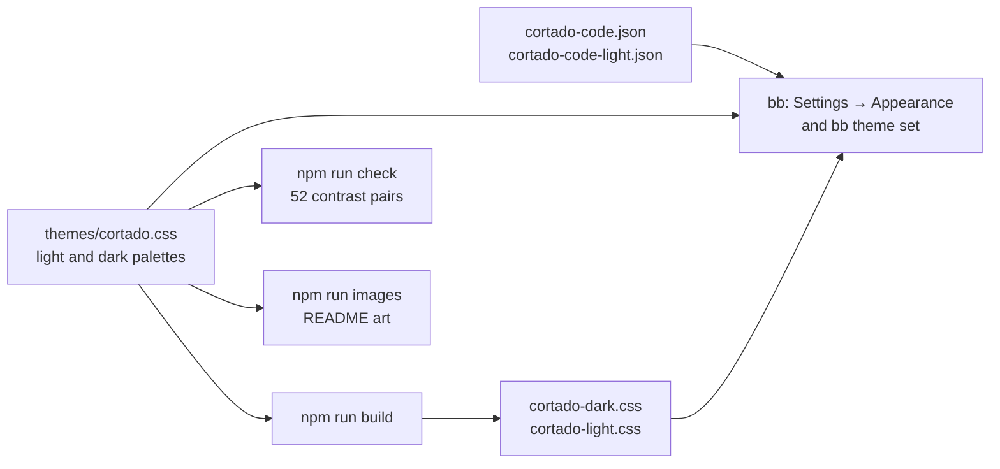

<p align="center">
  <picture>
    <source media="(prefers-color-scheme: dark)" srcset="assets/logo.svg">
    
  </picture>
</p>

<h1 align="center">Cortado</h1>

<p align="center"><b>A theme for <a href="https://getbb.app">bb</a> in neutral graphite with warm orange and amber, in light and dark.</b><br>Three palettes, matching code themes, and a contrast check that runs on every change.</p>

<p align="center">
<a href="https://github.com/vburojevic/bb-plugin-cortado/releases/latest"></a>

<a href="LICENSE"></a>

</p>



<p align="center"><sub>One bb window, dark on the left and light on the right.</sub></p>

## Install

```sh
bb plugin install git:github.com/vburojevic/bb-plugin-cortado@v1.0.0 --yes
```

> [!TIP]
> Then pick it under **Settings → Appearance → Palette**, or from a terminal:
>
> ```sh
> bb theme set plugin:cortado:cortado
> ```

> [!IMPORTANT]
> Code renders in [Fira Code](https://github.com/tonsky/FiraCode) and the terminal in [FiraCode Nerd Font Mono](https://www.nerdfonts.com/font-downloads). Install both first, or bb falls back to your system's monospace font.

## Three palettes

<picture>
  <source media="(prefers-color-scheme: dark)" srcset="assets/screens/palettes-trio-dark.png">
  
</picture>

**Cortado** follows bb's Light, Dark or System setting. **Cortado Dark** and **Cortado Light** keep one palette whichever way that switch is set. Each recolors the app, the syntax colors in chat, diffs and file previews, and the 16 terminal colors.

```sh
bb theme set plugin:cortado:cortado         # follows bb's mode
bb theme set plugin:cortado:cortado-dark    # always dark
bb theme set plugin:cortado:cortado-light   # always light
```

## A closer look

<table>
<tr>
<td width="50%" valign="top">

<picture>
  <source media="(prefers-color-scheme: dark)" srcset="assets/screens/diff-dark.png">
  
</picture>

### Diffs and file previews

bb draws diffs, file previews and the file editor with a code theme of its own. Cortado brings a matching one for each mode, so code reads the same in chat, in the diff and in the file.

</td>
<td width="50%" valign="top">

<picture>
  <source media="(prefers-color-scheme: dark)" srcset="assets/screens/palettes-dark.png">
  
</picture>

### Right in Settings

All three palettes appear under **Settings → Appearance → Palette**, next to bb's built-in ones.

</td>
</tr>
<tr>
<td width="50%" valign="top">

<picture>
  <source media="(prefers-color-scheme: dark)" srcset="assets/screens/menu-dark.png">
  
</picture>

### Depth you can read

Menus sit one step above the sidebar, and the sidebar one step above the chat, so every layer separates without heavy borders.

</td>
<td width="50%" valign="top">

<picture>
  <source media="(prefers-color-scheme: dark)" srcset="assets/screens/search-dark.png">
  
</picture>

### Warm where it counts

The amber accent marks what matters: search matches, focus, the unread line and primary buttons.

</td>
</tr>
</table>

<p align="center">
  <picture>
    <source media="(prefers-color-scheme: dark)" srcset="assets/screens/phone-dark.png">
    
  </picture>
  <br><sub>On a phone, tables, quotes and code still separate cleanly.</sub>
</p>

## Colors

<picture>
  <source media="(prefers-color-scheme: dark)" srcset="assets/palette.svg">
  
</picture>

The grays carry no tint, so the warm colors do the work. The accent is amber and warnings are orange. In dark mode the sidebar, icon rail, side panels and code sit one step above the chat, the way macOS raises its sidebars. In light mode they sit one step grayer than the white chat. Light mode uses a deeper amber, `#a86200`, so the accent still reads as text on white.

<picture>
  <source media="(prefers-color-scheme: dark)" srcset="assets/code.svg">
  
</picture>

Code keeps its warmth in two places, orange keywords and gold function names. Types, strings and numbers are teal, green and violet, so they never compete with the accent. Every color with a hue was tuned in OKLCH to sit in one band of lightness and saturation per mode.

## Contrast

`npm run check` reads every color from the stylesheet and tests 26 pairs in each mode against minimum contrast floors, most of them from WCAG. It fails if any pair falls short, or if the fixed palettes are out of date.

| Pair | Dark | Light | Floor |
| :-- | --: | --: | --: |
| Body text on the chat | 15.53:1 | 17.20:1 | 4.5:1 |
| Secondary text on the chat | 7.25:1 | 7.30:1 | 4.5:1 |
| Accent on the chat | 11.27:1 | 4.76:1 | 4.5:1 |
| Warnings on the chat | 9.65:1 | 5.09:1 | 4.5:1 |
| Errors on the chat | 7.97:1 | 5.70:1 | 4.5:1 |
| Code comments on code panels | 4.04:1 | 4.34:1 | 3:1 |
| Input borders on the chat | 3.03:1 | 3.39:1 | 3:1 |

## How it works



The stylesheet sets bb's own theme tokens and nothing else. It never targets bb's components, so there are no selectors to break when bb changes its markup.

<details>
<summary><b>Every surface, and where bb uses it</b></summary>
<br>

| Where in bb | Token | Dark | Light |
| :-- | :-- | :-- | :-- |
| Chat, thread header, composer bar | `--canvas` | `#070707` | `#ffffff` |
| Sidebar, icon rail, side panels, code | `--sidebar`, `--surface-recessed` | `#0f0f10` | `#f2f2f3` |
| Cards | `--card` | `#0f0f10` | `#f6f6f7` |
| Menus, popovers, the command palette | `--popover` | `#1c1c1e` | `#ffffff` |
| Secondary buttons, the current line in code | `--secondary` | `#252527` | `#ebebed` |
| Hovered rows in menus | `--accent` | `#2b2b2e` | `#e6e6e8` |
| Borders | `--border` | `#313134` | `#e1e1e3` |
| Input borders | `--input` | `#5c5c60` | `#8b8b90` |
| Selected cards, your own chips, quote bars | `--surface-selected-border` | `#85858a` | `#6b6b70` |
| Body text | `--ink` | `#e2e2e0` | `#1b1b1d` |
| Secondary text | `--muted-foreground` | `#9b9b9b` | `#56565b` |
| Accent, focus, primary buttons | `--primary` | `#ffb334` | `#a86200` |
| Warnings | `--warning` | `#ff9b50` | `#bf4712` |
| Errors | `--destructive-text` | `#fd7a86` | `#be2e4d` |
| Success, added lines | `--success` | `#71db9a` | `#107b49` |
| File paths | `--file-accent` | `#7dc9fc` | `#046eb6` |

</details>

<details>
<summary><b>Syntax colors in chat</b></summary>
<br>

bb highlights code blocks in chat with [sugar-high](https://github.com/huozhi/sugar-high), which reads its colors from `--sh-*` properties. Diffs and file previews use the code theme files instead, with the same colors.

| Property | Colors | Dark | Light |
| :-- | :-- | :-- | :-- |
| `--sh-keyword` | Keywords: `export`, `const`, `return` | `#fd9260` | `#b84703` |
| `--sh-entity` | Function names | `#f0cb6e` | `#8b6500` |
| `--sh-class` | Types and class names | `#55dcc8` | `#0c796e` |
| `--sh-string` | Strings | `#a6d77d` | `#487817` |
| `--sh-jsxliterals` | Numbers and JSX literals | `#b0b2fd` | `#5951c1` |
| `--sh-property` | Properties | `#b9c6d9` | `#4b5563` |
| `--sh-comment` | Comments | `#737373` | `#717176` |

</details>

<details>
<summary><b>Terminal colors</b></summary>
<br>

| # | Color | Dark | Light |
| --: | :-- | :-- | :-- |
| 0 | Black | `#3a3a3d` | `#3a3a3d` |
| 1 | Red | `#f05f5f` | `#c4262e` |
| 2 | Green | `#5fcf8c` | `#17774c` |
| 3 | Yellow | `#f0b04a` | `#a86200` |
| 4 | Blue | `#6db8f0` | `#0a6bbd` |
| 5 | Magenta | `#a99cf5` | `#6b45d1` |
| 6 | Cyan | `#52cdbd` | `#0a7a6d` |
| 7 | White | `#d0d0ce` | `#6b6b70` |
| 8 | Bright black | `#737373` | `#5f5f64` |
| 9 | Bright red | `#ff7b7b` | `#d12b33` |
| 10 | Bright green | `#7fe3a8` | `#1d8a59` |
| 11 | Bright yellow | `#ffc861` | `#b86e00` |
| 12 | Bright blue | `#8cd2ff` | `#1f7fd1` |
| 13 | Bright magenta | `#c3b1ff` | `#7c55e0` |
| 14 | Bright cyan | `#6fe3d3` | `#0d8f80` |
| 15 | Bright white | `#f2f2f0` | `#1b1b1d` |

</details>

<details>
<summary><b>Change it</b></summary>
<br>

A local install is read live, so you can tune the theme in place:

```sh
git clone https://github.com/vburojevic/bb-plugin-cortado
cd bb-plugin-cortado && npm install
bb plugin install . --yes
```

Edit `themes/cortado.css` for the app and `themes/cortado-code.json` or `themes/cortado-code-light.json` for diffs and file previews. Then:

```sh
npm run build    # regenerate Cortado Dark and Cortado Light from cortado.css
npm run check    # contrast in both modes, and stale files
npm run images   # redraw the logo, banner, palette and code images
bb theme set plugin:cortado:cortado
```

```
themes/cortado.css             light and dark palettes, shadows, fonts, terminal colors
themes/cortado-dark.css        Cortado Dark, generated
themes/cortado-light.css       Cortado Light, generated
themes/cortado-code.json       code theme for diffs and file previews, dark
themes/cortado-code-light.json code theme for diffs and file previews, light
scripts/build-variants.mjs     writes the two fixed palettes
scripts/check-contrast.mjs     the contrast check behind npm run check
scripts/render-images.mjs      draws the README art from the theme
docs/overview.md               the bb marketplace description
server.ts                      the empty server entry bb requires
assets/                        logo, banner and README images
```

</details>

<details>
<summary><b>About the images</b></summary>
<br>

The screenshots are captured from bb itself, running headless with its own empty data folder and this plugin installed from the `v1.0.0` tag. The threads show an invented change to a sample file. Nothing comes from anyone's real bb.

The logo, banner, palette and code images are drawn by `npm run images`, which reads every color from `themes/cortado.css` and the code theme files. Regenerating after a palette change keeps them honest.

</details>

## Credits

Fills and lines follow the step roles of [Radix Colors](https://www.radix-ui.com/colors/docs/palette-composition/understanding-the-scale). Type is [Inter](https://rsms.me/inter/) by Rasmus Andersson and [Fira Code](https://github.com/tonsky/FiraCode) by Nikita Prokopov. MIT licensed.

---

## More bb plugins

<p align="center">See every bb plugin I publish at <a href="https://github.com/vburojevic/bb-plugins"><b>vburojevic/bb-plugins</b></a>.</p>
